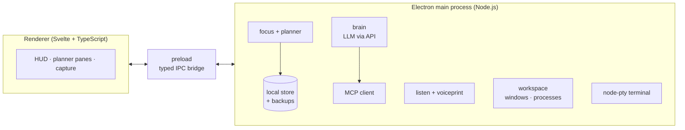

# J.A.R.V.I.S.: case study

**A personal desktop command centre: a voice-driven planner, focus system and PC controller with a sci-fi HUD.**

Source code: private, walkthrough available on request · Personal project · Sept 2026 to present

> J.A.R.V.I.S. started as a fork of [elecdex](https://github.com/kurouna/elecdex) by Shinsaku Nakagawa, an Electron and Svelte rewrite of eDEX-UI (GPL-3.0). I kept its terminal and system-monitor shell and built a full productivity and assistant layer on top. Everything described below is my work: 28 commits from September to November 2026.

---

## Why I built it

I wanted one tool that keeps me consistent: what I said I would do, what I actually did, and what to do next. It had to be fast to talk to, local-first, and free of distractions.

## What I built

**Planner and focus**
- Plain-language capture: type or say "finish the web report tomorrow" and it becomes a structured task with a due date
- Protocols, a daily Top 3, morning alignment and an evening debrief
- Focus sessions with honest time tracking, idle detection, presets and lockdown mode
- Foresight: time estimates, deadline risk and an energy map

**Voice and assistant**
- Spoken briefings and a listener mode, so it can be spoken to rather than operated
- An LLM "brain" reached through an API
- **MCP client:** J.A.R.V.I.S. can call external tools through the Model Context Protocol (including a fix so `npx`-launched servers work on Windows as typed)

**System control**
- Workspace control: OS windows and processes under voice and keyboard command
- Local-first memory, backups and sync, plus a phone view

**Phase 0, "the appliance" (shipped November 2026)**
- Windows installer, automatic planner backups, a global listener key, floating quick-capture and the HUD face

## Architecture

The interface never touches Node directly. Everything crosses a narrow, typed IPC bridge in the preload script, which keeps the renderer sandboxed.

## How I work on it

- A written, phased architecture spec: each phase ships something usable before the next one starts
- Quality gate on every change (`npm run verify`): Biome lint, type-checking for main, renderer and end-to-end code, and Vitest unit tests
- Playwright end-to-end tests and electron-builder packaging for the Windows installer

## Stack

| Area | Tools |
|---|---|
| App shell | Electron, electron-vite, electron-builder |
| UI | Svelte, TypeScript |
| System | node-pty, Windows window and process control |
| AI | LLM API, Model Context Protocol (client) |
| Quality | Vitest, Playwright, Biome, svelte-check |

## What I learned

- How Electron splits work between the main process, preload and renderer, and why the boundary matters for security
- Reading and extending a large codebase I did not write, and giving credit for it
- Shipping in phases instead of trying to build everything at once

---

Thabiso Motsitsi · [inkmastersonline@gmail.com](mailto:inkmastersonline@gmail.com) · [GitHub profile](https://github.com/inkmastersonline-cmd)
